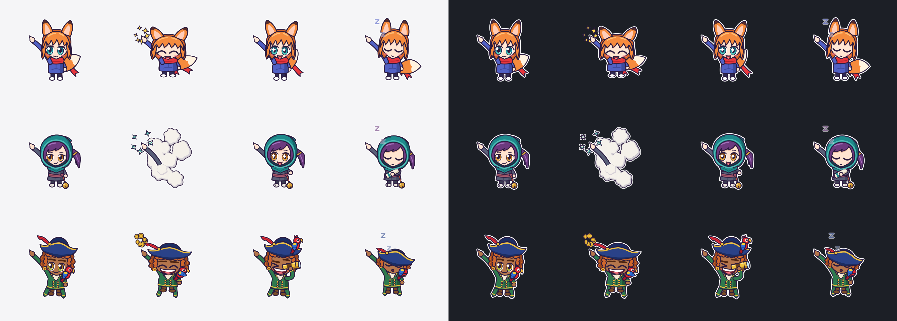
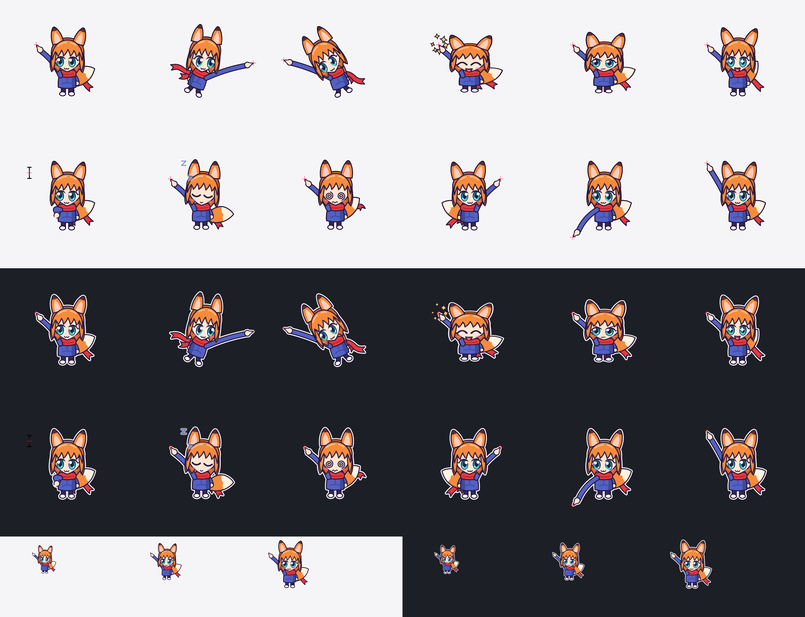

# Kiko Cursor

Turns your Mac's pointer into an original chibi character who lives in your menu bar. Pick Kiko the fox spirit, Suzu the ninja or Marlo the pirate. The character's fingertip is the pointer: clicks land exactly where it points.





## Run it

```bash
./scripts/install.sh
```

That builds the app, moves it to `/Applications` and opens it. Run it again after changing the code.

The app is for macOS 13 or later, on Apple silicon and Intel, as one universal build. Build it on a Mac with up-to-date Command Line Tools (tested with Swift 6.4, no Xcode needed), then copy the app to the Mac you want it on: the tools available for macOS 13 itself are too old to build it. It asks for no permissions: no Accessibility, no Input Monitoring, no Screen Recording.

- **Menu bar paw:** show or hide the character, pick who it is under **Avatar**, change the size and options, start at login, quit. Your pick is remembered.
- **⌃⌥K:** swap back to the normal pointer from anywhere.
- **Quitting or crashing** brings the normal pointer straight back, because macOS ties the hidden state to the process.
- **Start at Login** remembers where the app is. If you move the app out of `/Applications`, it won't start at login. Opening the app from its new location and switching the option off and on should fix that, though this hasn't been tested.

## What they do

All three move and react the same way, and use the same pointing arm, so the click point can't differ between them.

| When | The character |
| --- | --- |
| You move the mouse | Flies after the pointing hand, leaning, with scarf and tail trailing |
| You click | Squashes, smiles and throws sparkles |
| You hold the button | Looks focused |
| You hover a link | Eyes sparkle and ears perk up |
| The app wants a text, resize or crosshair cursor | Steps aside and shows the real cursor, so precision work stays readable |
| You shake the mouse | Gets dizzy |
| 25 seconds idle | Falls asleep, with Zs |
| You type | Fades to 25% until the mouse moves |
| Idle over a full-screen app, such as a video | Disappears until the mouse moves |
| You reach a screen edge | Moves to the other side of the pointer, to stay on screen |
| macOS insists on the real pointer, as in Mission Control | Steps aside until macOS lets go, so there's only ever one pointer |

What sets each one apart:

| | Kiko | Suzu | Marlo |
| --- | --- | --- | --- |
| **Look** | Fox ears and tail, red scarf | Teal hood, plum ponytail, small bell on a cord | Navy tricorn with a feather, brass-buttoned coat, parrot on the shoulder |
| **Moves** | Flies after the pointer | Quick and tight | Bobs and rocks as if on waves |
| **On a click** | Throws sparkles | Vanishes in a puff of smoke and throws paper shuriken; the arm stays, so you can still see where you're pointing | Scatters gold coins |
| **Over a link** | Eyes sparkle, ears perk up | Eyes light up | Raises a spyglass, and the parrot hops up to the hat |
| **Asleep** | Nods off, ears drooping | Hugs a scroll | Tips the hat over the eyes |

The character is excluded from screen capture by default, like the normal pointer, with a menu option to include it for demos. This exclusion hasn't been confirmed on macOS 26 yet, and some capture tools may ignore it.

## How it works

macOS has no public way to replace the system cursor, so the app does three things:

1. **Hides the real pointer** with `CGDisplayHideCursor`, plus the private `SetsCursorInBackground` connection property that makes it work while another app is frontmost. It's looked up at runtime: if a future macOS removes it, you get both pointers rather than a crash. Switching apps and reaching the menu bar bring the pointer back, so it's checked and re-hidden every frame.
2. **Follows the mouse with a click-through window** at cursor level, with the hotspot at its exact centre.
3. **Draws the character procedurally** with Core Graphics from spring physics, so there are no image assets and the art is sharp at any size.

`NSCursor.currentSystem` still reports what the frontmost app wants while the pointer is hidden, which is what makes the character context-aware.

| Path | What's in it |
| --- | --- |
| `Sources/KikoCore/Rig.swift` | Mouse input to pose: physics, expressions, screen edges. No AppKit |
| `Sources/KikoCore/Avatar.swift` | Who's on screen, and the numbers that make each one move differently |
| `Sources/KikoCore/KikoArt.swift`, `SuzuArt.swift`, `MarloArt.swift` | Pose to pixels: each character's art |
| `Sources/KikoCore/DrawKit.swift` | What they share, including the pointing arm |
| `Sources/KikoCore/Renderer.swift` | Picks the character's art for a pose and draws the real cursor when needed |
| `Sources/KikoCursor/Overlay.swift` | The window, frame loop and drawing surface |
| `Sources/KikoCursor/FrameClock.swift` | Frame timing: `CADisplayLink` on macOS 14 and later, `CVDisplayLink` on macOS 13 |
| `Sources/KikoCursor/CursorHider.swift` | Hiding and restoring the real pointer |
| `Sources/KikoCursor/SystemCursorWatcher.swift` | Working out which cursor the app wants |
| `Sources/KikoCursor/AppDelegate.swift` | Menu bar, hot key, lock screen and sleep handling |

## Checking it

```bash
swift run KikoCursor --check
```

Checks through the real physics and drawing, for every character: fingertip accuracy, nothing hides the finger, all ink fits the window, screen edges, reactions, recovery from stalls, settling to the idle frame rate, swapping characters.

```bash
swiftc -O scripts/livecheck.swift -o /tmp/livecheck -framework AppKit && pkill -x KikoCursor; /tmp/livecheck /Applications/KikoCursor.app/Contents/MacOS/KikoCursor
```

Quits any running Kiko, then runs the app and checks from outside it, through the window system, that the pointer is hidden, the window tracks the mouse, toggling works, a returned pointer is re-hidden quickly, and a clean quit or `kill -9` restores the pointer. It moves your real mouse for a few seconds but never clicks. It won't run with the screen locked or the display asleep, because no frames are drawn then. Add `--test-core-video-clock` after the app's path to test macOS 13's frame clock on a newer system.

```bash
arch -x86_64 /Applications/KikoCursor.app/Contents/MacOS/KikoCursor --check
```

Runs the checks on the Intel half of the app, on an Apple silicon Mac with Rosetta installed. For the live check, copy the app, keep only its Intel half with `lipo -thin x86_64`, re-sign the copy with `codesign --force --sign -`, and give livecheck that copy's binary. Rosetta doesn't show how fast the app is on a real Intel Mac.

```bash
swift run KikoCursor --avatar suzu --sheet sheet.png
```

Renders every pose through the real physics, on light and dark, with a red cross on the hotspot. Art changes are easiest to judge here. Leave out `--avatar` for Kiko; `--lineup PATH` puts all three side by side.

`--avatar NAME` also shows that character for one run without saving the choice. `--test-avatar-menu DIR` picks each character through the real menu, saves what's on screen to `DIR`, puts your saved choice back and quits.

Other developer flags: `--portrait PATH`, `--bench`, `--exit-after SECONDS`, `--dump-frame PATH`, `--print-status`, `--test-unhide-every SECONDS`, `--test-core-video-clock`, `--login-item on|off|status` (from inside the `.app` only). Running `pkill -USR1 KikoCursor` does the same as ⌃⌥K.

## Known limits

- **Distribution:** the private API rules out the Mac App Store. Selling it means a notarized direct download, which needs an Apple Developer ID. The current build has only an ad-hoc signature, so on other Macs Gatekeeper will block it.
- **macOS 13 and Intel:** so far the app has only run on macOS 26 on an Apple silicon Mac. There, macOS 13's frame clock has been tested by forcing it on, and the Intel build by running it under Rosetta. It has never run on real macOS 13 or a real Intel Mac, and CPU use on Intel is unmeasured.
- **Latency:** a window can't quite match the hardware cursor, so fast flicks may trail slightly. This hasn't been measured.
- **Secure screens:** the app restores the normal pointer when the screen locks. Some system-level surfaces may not show the character.
- **Multiple displays:** the code handles them, but so far it has only run on a single built-in display.
- **Crowded menu bars:** on a notched Mac, macOS can hide items that don't fit. If the paw is missing, ⌃⌥K still works, and `pkill KikoCursor` quits.
- **Spaces swipes:** the window list reports windows sliding during a swipe. Whether the character visibly moves with it for that half second hasn't been checked by eye.
- **Characters:** Kiko, Suzu and Marlo are all original. Named anime characters are copyrighted, so adding one, or something drawn to look like one, needs a licence from the rights holder.
